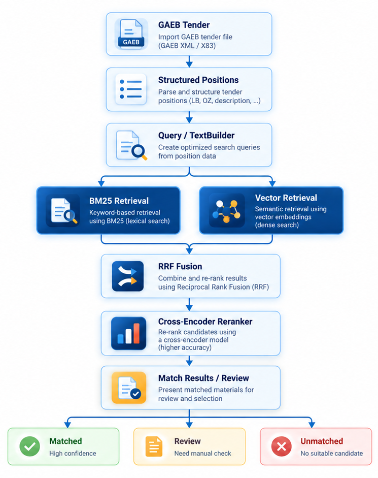

# CostPilot

**AI-assisted construction tender analysis and material matching.**

CostPilot is a modular platform that helps construction estimators work with *Leistungsverzeichnisse* (LV / bills of quantities). It transforms structured tender documents into searchable positions, retrieves relevant materials from a shared supplier catalog, and presents ranked matching suggestions for review.

The goal is to support faster, more consistent material selection during *Kalkulation*—not to replace an estimator's judgment about labor, site conditions, construction methods, or final pricing.

## How It Works


*Conceptual workflow. Attribute validation and automatic threshold-based match decisions are design goals; the current demo prioritizes ranked material recommendations and human review.*

### 1. Offline: Catalog Preparation

Supplier catalog data is prepared independently of individual projects:

1. **Catalog ingestion** — Parse supplier XML data and store product groups, commodity groups, commodities, and prices in PostgreSQL.
2. **Search preparation** — Generate normalized search text and structured material attributes, where available.
3. **Sparse indexing** — Build PostgreSQL full-text search representations and indexes to identify keyword-related candidates efficiently.
4. **Dense indexing** — Generate commodity embeddings with an embedding model and store them through `pgvector`.

The catalog and search data are **global and shared**; new projects and tenders do not require rebuilding the supplier catalog.

### 2. Online: Tender Matching

For each imported tender position, the matching pipeline follows this sequence:

1. **GAEB parsing and structured extraction** — Read the tender hierarchy and extract position identifiers (`OZ`), descriptions, quantities, and units into consistent domain models.
2. **Query building** — Combine relevant position text and available structured information into a retrieval query using the shared Core `TextBuilder`.
3. **Hybrid retrieval** — Run two complementary searches:
   - **BM25 retrieval:** Use PostgreSQL's full-text index for candidate selection, then apply BM25 scoring.
   - **Vector retrieval:** Encode the query and search stored commodity embeddings using `pgvector`.
4. **RRF fusion** — Merge the two ranked candidate lists using Reciprocal Rank Fusion, without directly comparing their incompatible raw scores.
5. **Cross-encoder reranking** — Evaluate query–commodity pairs with a reranker and sort the strongest candidates.
6. **Match results** — Associate suggestions with the original tender positions and persist the outcome for the user interface. Uncertain matches remain available for human review.



## System Modules

CostPilot is organized into independent repositories with clear responsibilities.

| Repository | Role | Key technologies and features |
| --- | --- | --- |
| [**costpilot-core**](https://github.com/costpilot-civil/costpilot-core) | Shared domain models and model-independent processing | GAEB/XML tender parsing, `Tender` and `Commodity` models, `TextBuilder`, RRF fusion, embedding and reranker interfaces |
| [**costpilot-backend**](https://github.com/costpilot-civil/costpilot-backend) | Business logic, API and online matching | Python, FastAPI, PostgreSQL retrieval, BM25 scoring, vector search, model inference, matching orchestration and result persistence |
| [**costpilot-database**](https://github.com/costpilot-civil/costpilot-database) | Data schema and offline preparation pipelines | PostgreSQL 17, `pgvector`, catalog XML import, search projections, embedding generation, relational integrity and indexes |
| [**costpilot-frontend**](https://github.com/costpilot-civil/costpilot-frontend) | User interfaces for project and tender workflows | React, TypeScript; browser-based web app and Tauri-based desktop app are the intended delivery formats |
| [**costpilot-deployment**](https://github.com/costpilot-civil/costpilot-deployment) | Unified runtime and deployment configuration | Docker Compose, Backend and PostgreSQL services, model mounts, environment configuration and persistent storage |

### Web and Desktop Experience

The frontend is designed around one consistent workflow: **create a project → upload a tender → run matching → inspect ranked results**. The intended interfaces are a browser-based application and a desktop application built with **Tauri**, sharing a React/TypeScript technology base. Frontend integration is ongoing.

## Getting Started

CostPilot uses a **centralized runtime and deployment configuration** in [**costpilot-deployment**](https://github.com/costpilot-civil/costpilot-deployment). Each module is developed in its own repository, while Docker Compose starts and manages the PostgreSQL and FastAPI services.

### Prerequisites

- Install **Docker** with Docker Compose and **uv** (for running the Database ingestion pipelines on the host).
- Clone `costpilot-core`, `costpilot-backend`, `costpilot-database`, and `costpilot-deployment` as sibling directories under one `costpilot/` directory.
- Provide `costpilot-deployment/.env` and `costpilot-deployment/config/models.yaml`, together with the local model weights in `costpilot-deployment/models/`.
- Place the supplier catalog XML input in the location expected by the Database import script. Source catalogs and model weights are not included in the public Git repositories.

### 1. Start PostgreSQL and Backend

Run these commands **from the `costpilot-deployment` directory**:

```bash
docker compose --env-file .env up -d --build
```

Docker Compose waits for PostgreSQL to become healthy before starting the FastAPI Backend. On the first start with an empty PostgreSQL data directory, the database image initializes the schema from `costpilot-database/sql/schema_v3.sql`. Existing database files are preserved across normal container restarts.

Check the running services:

```bash
docker compose --env-file .env ps
```

Once the Backend is running, open **http://localhost:8000/docs** for the interactive FastAPI documentation.

### 2. Import the Supplier Catalog and Build Search Data

The Database project's ingestion pipelines run **on the host**, not inside the Backend container. From the **same `costpilot-deployment` directory**, execute:

```bash
uv --directory ../costpilot-database run \
  --env-file ../costpilot-deployment/.env \
  python -m scripts.build_database all
```

This command uses the **Database repository's own `pyproject.toml` and Python environment**; no second Python environment or duplicate dependency setup is needed in Deployment. The working directory is switched to `costpilot-database` so the importer can resolve its existing relative XML paths.

The `all` pipeline imports commodity and pricing data, prepares search records and keyword indexes, and generates/stores commodity embeddings. It is intended for initial database preparation or an intentional rebuild, **not for every application startup**.

For host-side ingestion, the shared `.env` must provide a database connection accessible from the host (for example `POSTGRES_HOST=localhost` and `POSTGRES_PORT=5434`). The Docker Compose configuration separately overrides the Backend container's connection to `postgres:5432`. Model paths must also be resolvable in the respective host and container environments.

### 3. Stop the Services

From `costpilot-deployment`:

```bash
docker compose --env-file .env down
```

This stops and removes the managed containers without deleting the PostgreSQL bind-mounted data directory. For configuration details, see the [deployment repository](https://github.com/costpilot-civil/costpilot-deployment).

## Project Status

CostPilot is an **actively developed proof of concept**. The Core, Database and Backend modules implement the principal tender ingestion and hybrid matching flow; the frontend experience and end-to-end integration are being completed. The workflow illustration also includes planned decision-support capabilities that are not yet part of the validated demo.
